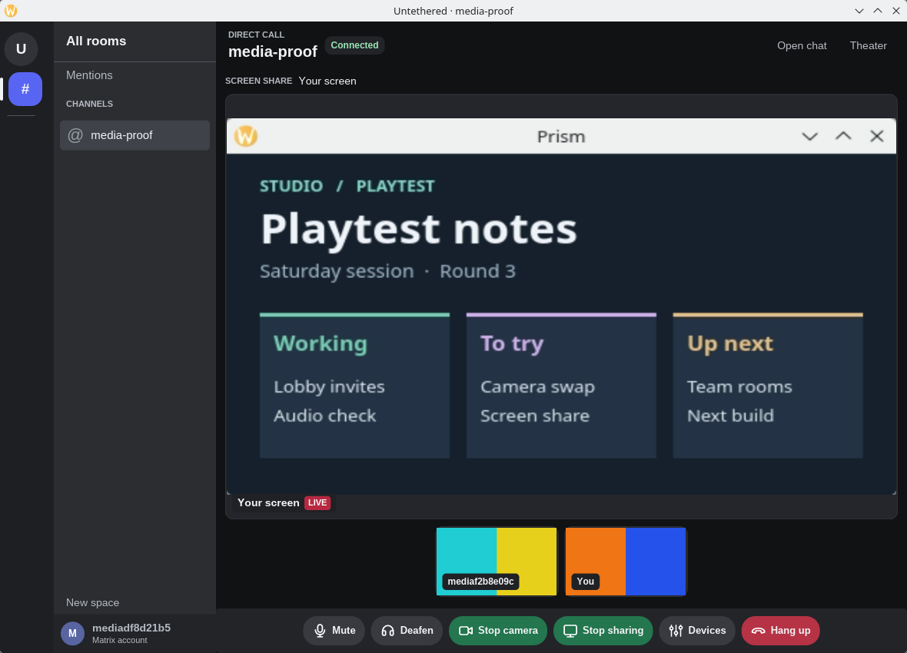
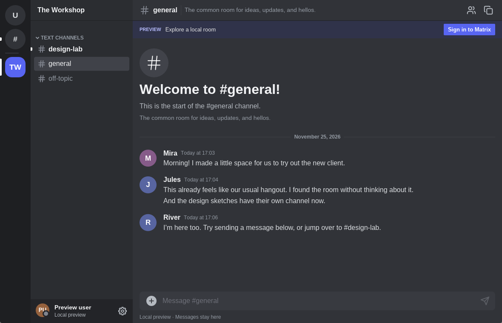

# Untethered

Untethered is written in Rust using Iced. Its Matrix engine is
[matrix-rust-sdk](https://github.com/matrix-org/matrix-rust-sdk), in process on
the desktop and in a Web Worker in the browser.

See the [Discord-parity roadmap and milestone checks](ROADMAP.md).

## Desktop

Try the native Discord-style frontend from the checkout:

```sh
bash scripts/rust-client.sh       # Linux x86-64, current Rust toolchain and system GUI libraries
```

On x64 Windows with Rust and the MSVC build tools: `.\scripts\rust-client.ps1`.
Both launchers store this client's session in `.dev/rust-profile`. Set
`UNTETHERED_PROFILE` to use a dedicated profile.

**How startup works:** The app locks the profile, restores its Matrix session
from `matrix-sdk/session.json`, opens its encrypted SQLite stores (the store
passphrase lives in the OS keyring when one answers) and syncs with Simplified
Sliding Sync, which the homeserver must support. There's no separate service
to start.

**Coming from a gomuks build:** earlier builds ran
[gomuks](https://github.com/gomuks/gomuks) as the Matrix engine. The first
start shows why you need to sign in again: it's a new device, and your
recovery key restores your encrypted history. Remove the old session under
**Devices** afterwards. gomuks's files in the profile are left alone. See the
[migration notes](rust-client/docs/matrix-sdk-migration.md).

The Linux launcher tries wgpu first and falls back to tiny-skia. To compare
renderers with the default development profile, close the client between runs
and test scrolling and typing in the same room with the same amount of history.

```sh
ICED_BACKEND=tiny-skia bash scripts/rust-client.sh
ICED_BACKEND=wgpu bash scripts/rust-client.sh
```

In Code OSS, **Ctrl+Shift+B** builds the Rust binary; **Terminal → Run Task →
untethered: Run** launches the desktop app.

The first launch opens a **local preview**: try the space rail, direct messages,
channel switching, the member list and copy buttons in the channel header, or the
composer (Enter sends, Shift+Enter adds a line). Preview messages are never sent and disappear when you quit. Choose
**Sign in to Matrix** for live rooms. Enter a homeserver such as `matrix.org`;
the client adds `https://`. This prototype supports password login and verification
with the account’s existing recovery key (grouped or compact) or recovery passphrase.
The web verification form supports ordinary keyboard and context-menu paste.
Single sign-on and emoji comparison (SAS) are desktop-only for now. Messages
show the formatting Element sends: bold, italic, strikethrough, inline code,
code blocks (hover one for **Copy**), quotes, lists, links, headings and
spoilers, which stay hidden until clicked. Plain messages from bots and
bridges get the same Markdown and Discord-style `||spoilers||`; raw HTML in
them stays text ([checked against Element](scripts/rich-text.md)). Profile
pictures and server icons load from the homeserver, cropped to circles;
anyone without one shows their initials.

**Discord-style layout:** Hover a message to show its toolbar: **Add Reaction**,
**Reply**, **Edit** (your own text messages) and **Report Message** (other
people’s). Header icons open notification settings, posting permissions, the
member list and room search; hover any icon for its name. Click the space name
at the top of the channel list for **Invite People**, **Create Channel** and
**Notification Settings**, or use **+** beside a channel category. **+** at
the bottom of the server rail creates a space. Click your name or the gear at
the bottom left for **User Settings**. Escape closes menus, dialogs and
settings. Category headers collapse; a collapsed category still lists unread
and selected channels.

**Right-click menus:** Right-click a message for everything its toolbar does
plus **Copy Text**, **Copy Message Link** (a matrix.to link) and **Mark
Unread** (Matrix receipts can't move back, so this marks the room unread).
Right-click a person (their picture or name on a message, or a member-list
entry) for **Profile** (their member card), **Mention**, **Message** (when
you already have a DM with them), **Copy User ID**, and **Kick…** / **Ban…**
when your power level allows; those open the member card, where you can add
a reason. Right-click a channel or DM in the sidebar for **Mark as Read**,
**Notification Settings**, **Copy Link** and **Leave**, which asks first.
Shift+F10 or the Menu key opens the menu for whatever is under the pointer,
or the newest message; arrow keys and Enter choose, Escape or a click
elsewhere closes it. There's no **Delete** yet: it comes with message
redaction.

**Replies:** Hover a message, click **Reply**, type your response, and send.
The bar above the composer shows who you’re replying to; its **×** (Cancel
reply) keeps your text. Click the quoted line above a reply to jump to the
exact Matrix event. If it
is outside the loaded timeline, Untethered loads that part of the room’s
history from the homeserver. **Preceding messages** shows what led up to it, and
**Back to latest** returns to the conversation.

**History:** Older messages load from the homeserver as you scroll up, a
screen before you reach the top, and a room opens with at least a screenful.
**Page Up** and **Page Down** scroll the messages, also while you type. Once
you're a screen or more above the newest message, a **Jump to present** bar
appears above the composer.

**Linux desktop notifications:** Click the bell (**Notification Settings**) in
the room header. **All
messages** enables ordinary message alerts; **Mute ordinary** quiets them
while higher-priority Matrix rules, such as direct mentions, still apply.
**Account default** removes the room override. The setting syncs with your
Matrix account. While Untethered is running, alerts go to the desktop
notification service; the room you’re currently viewing in a focused
window doesn’t also show a popup.

**Space alerts:** Select a space from the rail, click its name at the top of
the channel list, choose **Notification Settings**, and pick **All messages**
or **Mute ordinary**. The setting applies to joined
channels, including channels in nested spaces. An explicit room setting
takes priority. **Inherit** removes the space preference; the nearest
configured parent applies, or your account defaults if there is none.
For a shared room with equally close space settings, mute wins. Direct
mentions still follow your Matrix mention rule, and Do Not Disturb still
wins. Untethered updates the underlying Matrix push rules as it syncs
changes to space membership. [Linux and browser tests](scripts/room-alerts.md#verify-space-alerts).

**Do Not Disturb:** Open **User Settings** from the bottom of the sidebar and
choose **Pause alerts**. It silences message notifications across your Matrix account,
including direct mentions. Messages still arrive, and the mentions inbox still
updates. On Linux you can answer or decline an incoming call without a ringtone.
Choose **Resume alerts** on either Linux or web to restore the existing room
settings. [Cross-device and call tests](scripts/room-alerts.md#verify-account-wide-do-not-disturb).

**Mentions inbox:** Choose **Mentions** in the sidebar to see messages that
address your Matrix ID across joined rooms. Select an entry to open that
exact message in context. The inbox uses history readable on this device,
including encrypted messages, and survives restart. It updates while open;
a room-wide ping or a message that only spells out your ID is not a direct
mention. [Verified on Linux desktop and Chromium](scripts/mentions-inbox.md).

**Read state:** Reading the bottom of a focused conversation clears its
unread badge across your devices. A hidden browser tab, search results, or
a timeline scrolled up into history won’t do that. The **New messages**
divider shows where new messages begin when the read marker is loaded.
Use **Mark unread** below the composer to leave a reminder; it stays until
you choose **Mark read**, even after restart.

Read receipts are private by default. To let other room members see your
future reads, select **User Settings → Share receipts with room members**. Choose
**Keep receipts private** to stop sharing. Other people’s public receipts
appear as **Seen by** beneath the message. [Linux, Chromium and Element
test](scripts/read-state.md).

**Report a message:** Hover someone else’s message, click **Report Message**, enter
a reason, and choose **Submit report**. The report goes to your homeserver
administrator. In an encrypted room, the administrator can read your reason;
Untethered does not attach the decrypted message or post the reason to the room.
[Verified on Linux desktop and in Chromium](scripts/room-permissions.md#verify-message-reports).

**Room posting permissions:** Click the shield (**Posting Permissions**) in the
room header to see
the levels required for plain and encrypted messages. If your role allows it,
choose **Make read-only** to stop ordinary members from posting. Members with
sufficient power can still post announcements. **Restore posting** brings
back the previous posting levels, including inherited defaults, and keeps
rules another administrator changed in the meantime.

**Room membership:** Open the member list from the room header, find the member
by name or Matrix ID,
and select their row. **Kick** removes a joined member. They cannot post while
out, but can rejoin a public room without an invitation. **Ban** also prevents
rejoining. Either action accepts an optional reason. To readmit a banned
member, select their **Banned** row and choose
**Unban**. In an invite-only room, choose **Invite** separately. Their status
changes to **Joined** when they accept. Membership controls use your room role
and the selected account’s full Matrix ID.

**Room search:** Click the **Search** box in the room header, enter a word or phrase,
and press Enter. Results come from this device’s stored history and use the
current text of edited messages. **Check coverage** shows the number of
readable messages cached for this room and the oldest date it found. Open
a result to see it in context. **Back to results** keeps your query;
**Return to timeline** takes you back to where you were reading.

**Edits:** Hover one of your sent text messages or replies and click **Edit**.
Press Enter or **save edit** to update it in place; **cancel** or Escape discards
the change. Editing leaves your unsent composer draft alone. An edited reply
keeps its link to the original.

**Mentions, channels and emoji:** In the composer, a reply or an edit, type
`@` to list the room's members, `#` to list channels and `:` plus two letters
of a shortcode (`:tad`) to list emoji. Typing narrows the list; **↑** and **↓**
move, **Tab** or **Enter** inserts, a click inserts that row and **Escape**
closes the list. A finished `:shortcode:` turns into its emoji. A member you
pick is sent as a proper Matrix mention: a pill link in the formatted message
and their ID in `m.mentions`, so Element highlights the message for them and
it lands in their mentions inbox. Typing a name without picking it mentions
nobody. A channel becomes a `matrix.to` room link. The smiley button beside
**Send** opens the emoji picker and inserts at the cursor. [Element
test](scripts/replies-element.md#composer-autocomplete).

**Reactions:** Hover a message and click **Add Reaction** to choose a quick reaction,
search emoji by shortcode, or enter your own emoji or text. Click an existing reaction to add yours;
click a highlighted reaction to remove only yours. Reactions stay on the
same message when its text is edited. In encrypted rooms, Untethered and Element
use standard `m.reaction` events: the reaction key and target ID are visible
to the homeserver, while the message text remains encrypted.

**Files:** Drop files onto a room or click **+** to stage them, optionally type
a caption for the first attachment, then press **Send**. A local preview strip
shows image thumbnails or file-type cards; use **×** to remove a file. PNG,
JPEG, GIF and WebP previews are static. Oversized or unsupported images still
send as ordinary attachments within the upload limit. Each file is a standard
Matrix media event. Draft attachments stay in their original room when you switch.

**Media viewer:** Click an image or video in a room to open it over the
window. Images load at full size (originals up to 48 MiB); **←** and **→**
or the side arrows step through the room's images and videos, loading older
history past the first. **Escape**, **×** or a click outside closes it, and
**Download** saves the file. On Linux, videos play in the viewer through
GStreamer with play/pause (**Space** or a click on the picture), seeking and
mute; common codecs need `gst-plugins-good` and `gst-libav`. The decrypted
copy lives in `$XDG_RUNTIME_DIR` only while the viewer shows it. Elsewhere
the viewer shows the video's thumbnail and a Download button.
Uploads are sequential, with up to 10 staged files per room and a 64 MiB/file cap
(lower if the homeserver advertises a smaller limit). Click a received file’s
name or its **Download** button to save it. Preview mode simulates a send locally; it never uploads.

If a file is too large, the composer shows its name, size, and the limit
in bytes. Valid files from the same selection stay staged. If none fit,
your caption stays in the composer; choose another file or dismiss the
notice to send just the text. [Linux and Chromium limit tests](scripts/kwin-element.md#verify-plain-rooms-and-upload-limits).

On native Wayland you can drop a URI list or a file-transfer portal offer
from a sandboxed app. Portal files stay bound to the room that received the
drop, even if you navigate away before the desktop portal responds. The app
holds a read-only handle to each selected file while it is staged.

During upload the card shows the transfer percentage and a **Cancel** button.
Cancel stops the active upload and pauses the batch, keeping the files and
caption in the original room. **Retry** resumes the unsent files; files already
confirmed in the room are not sent again. Once an attachment is sending its
room event, it can no longer be cancelled as an upload.

To send a screenshot, copy it and press **Ctrl+V in the message composer**.
An image becomes a removable PNG attachment; plain text is inserted at the cursor.
The image stays local until Send. Linux Wayland reads the focused clipboard
through the app's existing data device; no clipboard watcher or helper daemon is needed.

Received images show an inline thumbnail in the active conversation. The client
uses encrypted Matrix thumbnails when available, or decodes a small original
(up to 4 MiB). Hover an image and click **Download** to save the original. The repeatable
`scripts/test-media-interop.py` test checks actual pixels in an independent browser
device after both login and reload against a disposable Synapse.

The [KWin/Element acceptance test](scripts/kwin-element.md) exercises a real
Dolphin multi-file drag, room switching during upload, and byte-for-byte PNG/PDF
downloads in both directions using the two clients’ visible controls.

**Linux DM calls (experimental):** Open an encrypted direct message with one
other joined user and click the phone icon (**Start Voice Call**). Element rings; when the recipient
accepts, Untethered uses the default microphone and output through `pacat`
(PulseAudio or PipeWire-Pulse). **Hang up** releases both streams. Calling
needs a verified Matrix device and a homeserver advertising a LiveKit
`livekit_service_url` with OpenID authorization. Source builds need Clang for
the LiveKit SDK. **User Settings → Check call server support** queries the homeserver's
MSC4143 RTC transports; legacy deployments can also advertise in `.well-known`.

With Untethered open, an incoming Element DM voice call plays a ringtone and
shows the caller, **Accept**, and **Decline**. Declining notifies Element
without opening your microphone. Accepting joins the existing encrypted call.
Either participant can hang up.

**Linux DM video (experimental):** Click the camera icon (**Start Video Call**)
in an encrypted DM.
The other person sees an incoming video invitation. Your camera is requested
through the Camera portal after they accept; accepting leaves **their**
camera off until they choose **Start camera**. The same camera control is
available during a voice call. The call starts in the sidebar dock, above
your profile. Click **Open call view** to expand it to the stage. Click
a participant tile to focus it; the dock keeps the call controls together.
**Stop camera** keeps the conversation going; **Hang up** releases capture.
[Two-way Linux video test](experiments/rtc-audio/README.md#verify-dm-video).

**To watch your own share:** click **Share screen**, choose a screen or window
in the desktop picker, then look for **Your screen · LIVE**. It opens on the stage.
If you switch to someone’s camera, click **Your screen** in the strip to watch
it again. Your choice of view doesn’t change what anyone else receives.
**Theater** hides the sidebars; **Open chat** returns to the docked preview.
[Live screen-share test and screenshots](experiments/rtc-audio/README.md#verify-the-call-stage).

When someone shares a browser tab **with audio**, the Linux client plays
the tab alongside their microphone. Uncheck **Play shared audio** to hear
just the conversation; this changes only your playback. **Deafen** silences
both and restores your previous choice when turned off.

**To send an app’s sound with your window:** start **Share screen**, play
audio in the app, then click **Choose app audio → Send sound from** and
select its playback stream. If it just started playing, click **Refresh
devices**. Only the selected stream is shared, even if other apps are
using the same speakers. **Stop app audio** leaves the video and microphone
running. Stopping the window share also stops the app recording. This
works with PulseAudio and PipeWire-Pulse and uses `pactl` and `parec`.



Video calls also work with **Element Web** in either caller direction.
When the other person turns off their camera, Untethered clears their last
frame and shows **No incoming video**. Turning the camera back on restores
the picture without redialing. [Element interoperability test](experiments/rtc-audio/README.md#verify-video-with-element).

If two Linux devices are signed into the same account, both can ring.
Answer or decline on either one: the other stops ringing and shows what
happened in the DM. Only the device that answers opens its microphone.
[Two-device call test](experiments/rtc-audio/README.md#verify-answering-on-another-device).

When you open another room during a Linux video call, the call bar shows
a small live view of the other person. **Hide preview** gives you more room
to type without stopping your camera. **Open call view** opens the full
view and keeps the draft in the room where you wrote it.

**Mute**
releases your microphone and leaves the other person audible. **Deafen**
silences playback and also mutes your microphone. **Undeafen** restores
playback and your previous mute setting.

Open **Devices** in the call bar to choose a **Microphone** and **Speaker**
independently. Each starts on **System default**. Switching affects only this
call, keeps its encrypted tracks connected, and preserves mute/deafen.
**Refresh devices** updates the list after plugging in or removing a device.

On Linux, choose **Devices → List cameras** to list sources allowed by your
desktop Camera portal. Pick a camera before starting video, or switch while
it’s on. A live switch updates your preview and the other participant’s
picture without redialing. If the selected camera disappears, your video
stops; choose another camera and press **Start camera** to resume.
[Camera switching test with Element](experiments/rtc-audio/README.md#verify-live-camera-switching).

During a network interruption, the Linux call bar shows **Reconnecting**.
A DM call releases the audio devices; a voice room keeps your microphone and
stops playback. When connectivity returns, encrypted audio resumes on the same
call membership. After a longer outage (16 seconds or more), the homeserver has
already ended your membership. Untethered then rejoins on its own with a new
membership and a new encryption key, for up to five minutes, and doesn't ring
again. A DM rejoins only while the other person is still in the call: when they
hang up, or their client leaves once you have, as Element does, the call ends.
If the other person's connection drops instead, your call waits for them to
rejoin. The [voice-room reconnect test](experiments/rtc-audio/README.md#verify-voice-room-recovery)
covers short outages, a blocked SFU and a rejoin.

If direct media is blocked, both clients can use the TURN relay advertised by
LiveKit. The [relay-only test](experiments/rtc-audio/README.md#verify-turn-only-calls)
verified encrypted audio with either Untethered or Element initiating.
The [two-desktop test](experiments/rtc-audio/README.md#two-native-linux-desktops)
also verified calling in both directions between Linux Untethered clients.
An unanswered invitation times out after 45 seconds without opening either
microphone. A server without a supported call transport shows an error
before anyone is rung.

The [desktop call tests](experiments/rtc-audio/README.md) drive both clients'
actual call controls and measure audio through isolated Linux devices.

**Linux voice rooms (experimental):** Open an existing encrypted Matrix call
room (`org.matrix.msc3417.call`, marked **♪**) and click **Join voice**.
People in voice appear under the room name. While you’re connected, each
person talking, including you, gets a green ring around their avatar and a
green speaker icon after their name. Both clear when their microphone goes
quiet. Joining never rings the other
members. **Leave voice** disconnects only your device; the others can keep
talking. The [three-person test](experiments/rtc-audio/README.md#verify-three-person-voice-rooms)
uses three Linux clients on the same MatrixRTC LiveKit service.
Room permissions must allow publishing call membership and, for the first
participant, opening the voice slot if it is not already open.

Open **Mixer** in the call bar, in a voice room or a DM call, to change how
loud each person sounds to you for this call. Drag their slider from **0%** (silent for you)
to **200%**, or click **Reset** to return to **100%**. Other listeners keep
their own mixes.

For **Push-to-talk**, check the box beside **Join voice** or in the call bar.
Hold the key the call bar names to send your voice. Your microphone closes
100 ms after you let go, so the end of a word isn't cut off; you still hear
the room. **Mute** and **Deafen** override the key, and after either you
press it again to talk. The choice carries over to your next voice room
until you quit the app.

While push-to-talk is on, the key also works when another application has
focus:

- **X11:** hold **Right Ctrl**. Untethered only listens (XInput2 raw key
  events), so the focused application still gets the key too.
- **Wayland:** turning push-to-talk on asks your desktop to bind three
  shortcuts: **Push to talk** (Pause suggested), **Toggle mute**
  (Ctrl+Shift+M) and **Toggle deafen** (Ctrl+Shift+D). Change or clear them
  in that dialog (on KDE, *Global Shortcuts Requested*; later under System
  Settings › Shortcuts). It needs the GlobalShortcuts portal (KDE Plasma
  5.27 or later, GNOME 48 or later). The installed package names itself
  to the portal as `io.github.koalexbear.Untethered`, so the dialog says
  Untethered and later launches reuse your keys without asking again; a run
  from the checkout has no installed desktop file, and the desktop names the
  app after whatever launched it. The desktop keeps a bound key to
  itself: it no longer reaches the focused application, so choose one you
  don't type with. A modifier on its own, such as Right Ctrl, can't hold
  the microphone open there, because KDE fires those shortcuts on release.
- **Right Ctrl** always works while Untethered is focused. Without a
  desktop-wide key (no portal, or you cancel the dialog), switching
  applications closes your microphone.

`UNTETHERED_GLOBAL_SHORTCUTS=0` keeps only the in-window key.
`UNTETHERED_PTT_KEY` replaces the desktop-wide push-to-talk key, written as
the desktop shortcut format writes it (`Pause`, `F9`, `CTRL+grave`). On X11
it accepts modifier keys, Pause, Scroll_Lock, Insert, Menu, F1 to F35 and
single characters.

In the voice-room call bar, click **Share screen** and pick a screen or a
window in your desktop's chooser. Other participants see it live; **Open call
view** puts it on the stage. Shares keep their source size up to 1920×1080 and
send up to 30 fps (2.5 Mbps cap); the pointer is included when the portal
offers it. Cameras send 1280×720 at up to 30 fps (1.7 Mbps cap). A 1600×900
test window arrived at 1600×928 and 30 fps on both receivers
([measurements](experiments/rtc-audio/README.md#verify-portal-window-sharing)).
You can browse another channel and use **Stop sharing** there without
leaving voice. Capture requires a ScreenCast portal backend, PipeWire and
GStreamer (`gst-launch-1.0`, `pipewiresrc`, and the base video plugins).
The share carries screen pixels; microphones remain separate encrypted tracks.

**Start camera** uses the Linux Camera portal and the camera selected under
**Devices** (system default initially). Other participants see a **Camera** tile with your name.
**Stop camera** releases capture and removes the tile while voice continues.
Camera and window sharing have independent controls and encrypted tracks.

Incoming video appears in a grid in the voice room. Click any tile to
enlarge it; the other feeds stay live as thumbnails. Click a thumbnail to
switch focus, or **Back to grid** to see everyone at equal size. Your choice
only changes your view. If the focused feed ends, the grid returns automatically.



## Browser

The browser runs the same Rust view, with the matrix-rust-sdk engine in a Web
Worker. Its Matrix device lives in the browser's IndexedDB, independently of
the desktop profile. Use a modern browser at `localhost` or an HTTPS origin.

Only one tab can use the browser device at once. Another tab waits and connects
automatically when the active tab closes. Keep the site data: that’s where the
device’s encryption keys live. A browser that ran an earlier gomuks build signs
in once more, as on the desktop.

**Browser notifications:** In a room, open **Alerts → Enable browser
notifications** and allow the site in your browser’s prompt. **Mute
ordinary** suppresses routine messages while retaining direct mentions
under the default Matrix mention rule. Keep Untethered open: it can notify
from a background tab, and clicking the notification returns to its room.
If you previously blocked notifications, change the permission in your
browser’s site settings. [Verified in desktop Chromium on Linux](scripts/room-alerts.md#verify-browser-tab-notifications).

```sh
rustup target add wasm32-unknown-unknown
# Requires Trunk and wasm-bindgen-cli matching Cargo.lock.
bash scripts/rust-web.sh
python3 -m http.server 8080 --bind 127.0.0.1 --directory rust-client/web/dist
```

Open `http://127.0.0.1:8080`. The engine, room model and Iced view are in
`rust-client/src`. `cargo test --manifest-path rust-client/Cargo.toml` runs the
unit tests; `scripts/qa_matrix_sdk.py` runs the live engine tests against a
disposable Synapse, and its `UNTETHERED_QA_ONLY=web` mode the browser test.

## Arch Linux package (x86-64)

Run `makepkg -s` in the checkout to build the **current local Git commit**.
The package installs `/usr/bin/untethered` (and the camera helper in
`/usr/lib/untethered`). Since `0.1.0-9` it no longer ships gomuks. Since
`0.1.0-10` its desktop file is `io.github.koalexbear.Untethered.desktop`,
the app ID its window and desktop portal requests carry. Since `0.1.0.r144`
the version names the commit it was built from
(`0.1.0.r<commit count>.g<short hash>`), so each new commit is an upgrade.
The packaged app keeps its Matrix device in `$XDG_DATA_HOME/untethered-iced`
(default `~/.local/share/untethered-iced`), separate from the development profile.
An [in-place upgrade from `0.1.0-2` to `0.1.0-6`](scripts/linux-upgrade.md#recorded-run-2026-11-25)
preserved the device ID and both public keys. The upgraded app decrypted
old and new messages from Element without signing in again.

With paru, the repository can be a PKGBUILD repository: an `[untethered]`
section in `paru.conf` with `Url = https://github.com/koalexbear/untethered.git`
and `GenerateSrcinfo`. The repository commits no `.SRCINFO`, and without
`GenerateSrcinfo` paru keeps the first one it generated, with that build's
version. `paru -Syu` then fetches new commits along with the package
databases and offers the upgrade; `paru -Sya` skips PKGBUILD repositories.
